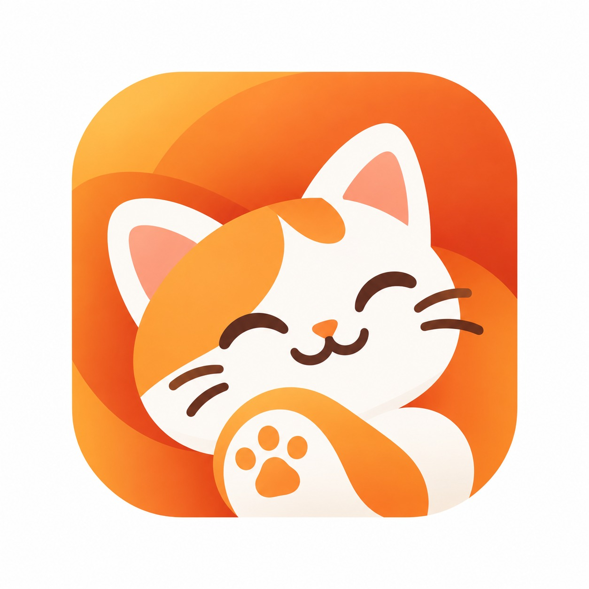

# Meowtopia Super App

<p align="center">
  
</p>

Platform kolaborasi lima kelompok Capstone Universitas Telkom untuk pengelolaan dan kesejahteraan kucing kampus. Monorepo ini berisi backend Laravel 11 dan frontend Flutter.

**Status: pengembangan dan integrasi.** Route dan tampilan yang tersedia belum berarti seluruh proses bisnis sudah tersambung ke server. Mode data contoh frontend aktif secara bawaan.

Mulai dari [konfigurasi frontend](#menjalankan-frontend), [konfigurasi backend](#menjalankan-backend), lalu baca [aturan kolaborasi](#aturan-kolaborasi). Panduan Flutter yang lebih rinci ada di [README frontend](frontend/README.md). Dokumen PRD pada folder `docs/` disimpan lokal dan tidak ikut dipublikasikan; minta salinannya kepada PM atau pemilik kelompok.

## Pembagian tanggung jawab

| Kelompok | Fitur | Backend | Frontend |
| --- | --- | --- | --- |
| Acumalaka | Adopt Feeding Spot | `backend/app/Modules/FeedingSpot/` | `frontend/lib/features/feeding_spot/` |
| SUPER-SUB | Cat Hunter / Telcat | `backend/app/Modules/CatHunter/` | `frontend/lib/features/cat_hunter/` |
| E-Nigma | Adopsi dan rehoming | `backend/app/Modules/CatAdoption/` | `frontend/lib/features/cat_adoption/` |
| Optimind | Lapor insiden | `backend/app/Modules/IncidentReport/` | `frontend/lib/features/incident_report/` |
| Rekans Caps | Identifikasi kucing | `backend/app/Modules/CatIdentification/` | `frontend/lib/features/cat_identification/` |

Setiap kelompok mengelola UI, model, layanan, provider, controller, request, route, dan migration di wilayahnya. Pembagian ini merupakan aturan kolaborasi; lokasi branch tidak membatasi file yang bisa ikut masuk commit.

Bagian bersama yang memerlukan koordinasi PM/Technical Lead dan pemilik modul terdampak:

| Area | Lokasi |
| --- | --- |
| Autentikasi, pengguna, master kucing | `backend/app/Modules/Core/`, `backend/app/Modules/Cat/`, `backend/app/Models/User.php`, `frontend/lib/features/auth/`, `frontend/lib/features/cat/` |
| Dashboard dan navigasi global | `frontend/lib/features/home/`, `frontend/lib/features/shell/`, `frontend/lib/features/activity/`, `frontend/lib/features/profile/` |
| Fondasi frontend | `frontend/lib/core/`, `frontend/lib/main.dart`, `frontend/lib/app.dart` |
| Fondasi backend | `backend/bootstrap/`, `backend/routes/`, `backend/app/Providers/`, `backend/app/Support/` |
| Dependency dan konfigurasi platform | `backend/composer.json`, `backend/composer.lock`, `frontend/pubspec.yaml`, `frontend/pubspec.lock`, `frontend/analysis_options.yaml`, `frontend/android/`, `frontend/ios/`, `frontend/web/`, `.gitignore` |

## Prasyarat

| Kebutuhan | Konfigurasi |
| --- | --- |
| Git | Akses repository tim dan identitas commit sendiri |
| Flutter | Versi lokal yang dipakai: **3.47.9**, dengan **Dart 3.13.7** |
| Dependency frontend | Lockfile saat ini mensyaratkan Dart `>=3.13.0` dan Flutter `>=3.44.0`; SDK harus memenuhi keduanya |
| Backend | PHP `>=8.2`, Composer 2, serta ekstensi yang diminta Composer |
| Database lokal bawaan | SQLite dengan ekstensi PHP `pdo_sqlite` |
| Android, bila diperlukan | Android SDK, JDK 17, emulator atau HP; runner menargetkan API 24+ |
| iOS, bila diperlukan | macOS dan Xcode; runner menargetkan iOS 15+ |

Batas SDK di `pubspec.yaml` mengikuti kebutuhan lockfile: Dart `>=3.13.0` dan Flutter `>=3.44.0`. Gunakan versi Flutter tim yang memenuhi keduanya; jangan menghapus lockfile untuk melewati kesalahan versi.

Folder `.tools/` hanya alat lokal dan tidak ikut Git. Clone baru tidak otomatis mendapat SDK di folder tersebut.

## Menjalankan frontend

Jalankan dari root repository dengan Flutter yang sudah tersedia di PATH:

```powershell
cd frontend
flutter --version
flutter doctor
flutter pub get
flutter run -d web-server --web-port=5782
```

Buka **http://localhost:5782**. Mode ini dapat menampilkan dashboard dan alur contoh AFS tanpa backend. Login dan modul lain masih memerlukan API.

Gunakan `r` untuk hot reload, `R` untuk hot restart, dan `q` untuk berhenti. Setelah mengganti `--dart-define`, hentikan proses lalu jalankan kembali dengan parameter baru.

Contoh menghubungkan browser ke backend lokal:

```powershell
flutter run -d web-server --web-port=5782 --dart-define=MEOWTOPIA_DEMO=false --dart-define=MEOWTOPIA_API_URL=http://127.0.0.1:8000/api/v1
```

| Frontend dijalankan di | Alamat backend |
| --- | --- |
| Browser pada komputer backend | `http://127.0.0.1:8000/api/v1` |
| Android Emulator standar | `http://10.0.2.2:8000/api/v1` |
| HP fisik | `http://IP_LAN_KOMPUTER:8000/api/v1`, sesuai jaringan lokal |

Alamat bawaan di kode adalah alamat emulator. Setiap developer mengatur alamat melalui `--dart-define`; tidak perlu mengganti konstanta bersama. Panduan perangkat, izin kamera, dan kendala koneksi ada di [README frontend](frontend/README.md).

## Menjalankan backend

Contoh berikut memakai PowerShell, database lokal baru, dan dijalankan dari root repository. Jangan menimpa `.env` atau database yang sudah digunakan.

```powershell
cd backend

$runtimeDirectories = @(
    'bootstrap/cache',
    'storage/app/private',
    'storage/app/public',
    'storage/framework/cache/data',
    'storage/framework/sessions',
    'storage/framework/views',
    'storage/logs'
)
foreach ($runtimeDirectory in $runtimeDirectories) {
    New-Item -ItemType Directory -Path $runtimeDirectory -Force | Out-Null
}

if (-not (Test-Path -LiteralPath '.env')) {
    Copy-Item -LiteralPath '.env.example' -Destination '.env'
}
if (-not (Test-Path -LiteralPath 'database/database.sqlite')) {
    New-Item -ItemType File -Path 'database/database.sqlite' | Out-Null
}

composer install
```

Sesuaikan nilai berikut dalam `backend/.env` untuk konfigurasi lokal:

```dotenv
APP_ENV=local
APP_DEBUG=true
APP_URL=http://127.0.0.1:8000
DB_CONNECTION=sqlite
DB_DATABASE=database/database.sqlite
SESSION_DRIVER=file
CACHE_STORE=file
QUEUE_CONNECTION=sync
```

Migration yang tersedia belum membuat tabel `sessions`, `cache`, dan `jobs`, sedangkan `.env.example` masih memilih driver database untuk ketiganya. Pengaturan lokal di atas menghindari ketergantungan pada tabel tersebut.

Untuk instalasi baru, buat application key lalu jalankan migration dan seeder:

```powershell
php artisan key:generate
php artisan migrate --seed
php artisan route:list --path=api
php artisan serve --host=127.0.0.1 --port=8000
```

Buat key hanya pada instalasi baru yang `APP_KEY`-nya kosong. Pertahankan key milik instalasi yang sudah berjalan. Jika konfigurasi lama masih tersimpan setelah perubahan `.env`, jalankan `php artisan config:clear`.

| Pemeriksaan | URL |
| --- | --- |
| Kesehatan aplikasi | `http://127.0.0.1:8000/up` |
| Gateway API | `http://127.0.0.1:8000/api` |
| Daftar spot | `http://127.0.0.1:8000/api/v1/feeding-spots` |

Gateway berada di `/api`; `/api/v1` merupakan prefix endpoint modul. Seeder saat ini membuat akun admin dan mahasiswa contoh, belum mengisi kucing atau feeding spot. Detail akun lokal ada di [DatabaseSeeder.php](backend/database/seeders/DatabaseSeeder.php); jangan gunakan akun contoh untuk deployment.

Untuk HP pada jaringan yang sama, jalankan server dengan `php artisan serve --host=0.0.0.0 --port=8000`, gunakan IP LAN komputer, dan izinkan koneksi pengembangan pada firewall.

Setup ini menyesuaikan scaffold repository. Rujukan framework tersedia pada [instalasi Laravel 11](https://laravel.com/docs/11.x/installation) dan [konfigurasi Laravel 11](https://laravel.com/docs/11.x/configuration). Perintah backend belum diuji sampai akhir pada lingkungan baru.

## Batas integrasi saat ini

| Bagian | Kondisi |
| --- | --- |
| Dashboard, navigasi, dan AFS contoh | Dapat dipratinjau; perubahan contoh berada di memori dan hilang saat aplikasi dimuat ulang |
| Daftar spot melalui API | Menggunakan `GET /api/v1/feeding-spots`; daftar kosong bisa berarti belum ada data |
| QR kucing | Memakai layanan identifikasi dan token kalung `MEOW-CAT-...` |
| Sesi AFS dan unggah bukti produksi | Belum tersedia; mode API menolak pembukaan sesi |
| Verifikasi dan ledger reward AFS | Belum tersambung sesuai rancangan baru |
| Aktivitas pribadi lintas fitur | Frontend menunggu `GET /api/v1/activities/mine`; endpoint backend belum tersedia |
| Penukaran poin dan voucher | Belum merupakan fitur siap pakai |

Endpoint lama `POST /api/v1/feeding-spots/record` langsung membuat aktivitas terverifikasi dan memberi 15 poin. Alur bukti AFS yang baru sengaja tidak memanggilnya. Jangan menyambungkan endpoint ini sebagai pengganti sesi, review, atau ledger tanpa keputusan tim.

Mode contoh tidak memalsukan seluruh API aplikasi. Lihat [cakupan mode data](frontend/README.md#mode-data-dan-integrasi) sebelum menguji fitur masing-masing.

## Aturan kolaborasi

### Batas perubahan

1. Kerjakan fitur di folder kelompok sendiri. Perubahan pada domain kelompok lain memerlukan persetujuan pemilik modul sebelum digabungkan.
2. Untuk perubahan bersama, jelaskan file, alasan, dan dampaknya. Dapatkan persetujuan PM/Technical Lead serta pemilik modul terdampak sebelum penggabungan.
3. Dashboard menautkan fitur melalui route dan kontrak yang disepakati. Logika bisnis tetap dikelola pemilik modul.
4. Format hanya folder atau file yang dikerjakan. Perapian massal seluruh repository harus menjadi perubahan terpisah.
5. Dependency, versi SDK, migration, dan konfigurasi platform harus dibahas lintas kelompok sebelum diubah.
6. Jangan menimpa kode kelompok lain saat konflik. Tinjau bersama pemilik bagian yang bentrok.

### Database dan API

- Letakkan migration di `backend/app/Modules/<Modul>/Database/Migrations/`. Gunakan nama tabel yang jelas, `snake_case`, dan sesuai modul.
- Migration yang sudah dibagikan atau digabung tidak boleh diedit untuk mengubah riwayat schema; buat migration baru.
- Relasi ke `users` dan `cats` memakai tabel bersama. Sepakati aturan penghapusan; `nullOnDelete()` membutuhkan kolom nullable.
- Jangan menjalankan `migrate:fresh`, menghapus database, atau mengganti seeder pada database bersama.
- Route modul didefinisikan di `backend/app/Modules/<Modul>/routes.php`. `ModuleServiceProvider` memasang prefix `/api/v1` dan memuat migration.
- Gunakan `App\Support\ApiResponse` untuk respons controller. Pertahankan `status`, `message`, `data`, dan bentuk paginasi yang dibaca frontend.
- Endpoint privat memakai autentikasi, otorisasi, dan pembatasan data akun yang sesuai; menerima Bearer token saja bukan pemeriksaan kepemilikan data.
- Perubahan endpoint, field, status, enum, dan pagination perlu disepakati frontend/backend lalu dicatat dalam PR.

### Branch, commit, dan PR

Alur integrasi yang dituju:

```text
feature/<fitur>-<kelompok> -> development -> main
```

PM/maintainer menyiapkan `development`, reviewer, dan proteksi branch. Jika branch integrasi belum tersedia, anggota meminta penetapan branch dasar kepada PM. Aturan dalam README tidak otomatis mengaktifkan proteksi GitHub.

| Kelompok | Contoh branch |
| --- | --- |
| Acumalaka | `feature/feeding-spot-acumalaka` |
| SUPER-SUB | `feature/cat-hunter-supersub` |
| E-Nigma | `feature/cat-adoption-enigma` |
| Optimind | `feature/incident-report-optimind` |
| Rekans Caps | `feature/cat-identification-rekanscaps` |

Urutan kerja setelah branch integrasi tersedia dan working tree bersih:

```powershell
git status --short
git fetch origin
git switch development
git pull --ff-only origin development
git switch -c feature/feeding-spot-acumalaka
```

Jika branch fitur sudah ada, gunakan `git switch <nama-branch>`. Jangan memindahkan branch atau membuang perubahan saat masih ada pekerjaan lokal yang belum diamankan.

Sebelum commit, tinjau dan stage path yang memang menjadi cakupan pekerjaan. Contoh dari root repository untuk Acumalaka:

```powershell
git diff --name-only
git diff -- frontend/lib/features/feeding_spot backend/app/Modules/FeedingSpot
git add -- frontend/lib/features/feeding_spot backend/app/Modules/FeedingSpot
git diff --cached --name-only
git diff --cached
```

Tambahkan file bersama secara spesifik setelah perubahan dikoordinasikan. Hindari staging semua file ketika ada pekerjaan beberapa kelompok dalam satu checkout.

Setelah cakupan staging dan izin publikasi jelas, anggota yang berwenang dapat melakukan commit/push pada branch fiturnya lalu membuka PR menuju `development`. Contoh untuk branch Acumalaka:

```powershell
git commit -m "feat(feeding-spot): catat bukti pemberian makan"
git push -u origin feature/feeding-spot-acumalaka
```

- Jangan commit/push langsung ke `main` atau menggabungkan PR sendiri tanpa persetujuan reviewer yang ditunjuk.
- PR fitur menuju `development`; penggabungan ke `main` dilakukan PM/maintainer setelah integrasi diperiksa.
- Sinkronkan pembaruan `origin/development` ke branch fitur sebelum PR; selesaikan konflik bersama pemilik modul.
- Commit lockfile aplikasi: `frontend/pubspec.lock` dan `backend/composer.lock` ketika tersedia. Backend saat ini belum memiliki `composer.lock`; hasil resolusi awal perlu ditinjau maintainer.
- Jangan commit `.env`, token, database lokal, `vendor/`, `bootstrap/cache/`, hasil build, SDK, atau cache editor. Periksa staging meskipun ada `.gitignore`.
- Pada sesi kerja berbantuan alat, commit, push, dan perubahan GitHub tetap memerlukan izin eksplisit pemilik pekerjaan.

## Pemeriksaan sebelum PR

| Area | Pemeriksaan |
| --- | --- |
| Frontend | Format file yang diubah, `flutter analyze`, `flutter build web --no-wasm-dry-run`, dan uji interaksi fitur terkait |
| Backend | `composer validate`, migration pada database lokal terpisah, `php artisan route:list --path=api`, serta uji respons dan otorisasi endpoint yang diubah |
| Bersama | `git diff --check`, daftar file, perubahan dependency/kontrak, dan konflik yang sudah diselesaikan |

Suite tes otomatis frontend dan konfigurasi tes backend belum tersedia dalam source saat ini. Cantumkan pemeriksaan yang benar-benar dijalankan; analyzer atau build tidak membuktikan seluruh alur bisnis bekerja.

PR wajib memuat masalah yang diselesaikan, perilaku setelah perubahan, cakupan folder, cara menjalankan, hasil pemeriksaan, kebutuhan reviewer lintas modul, dan batas integrasi yang masih tersisa.
