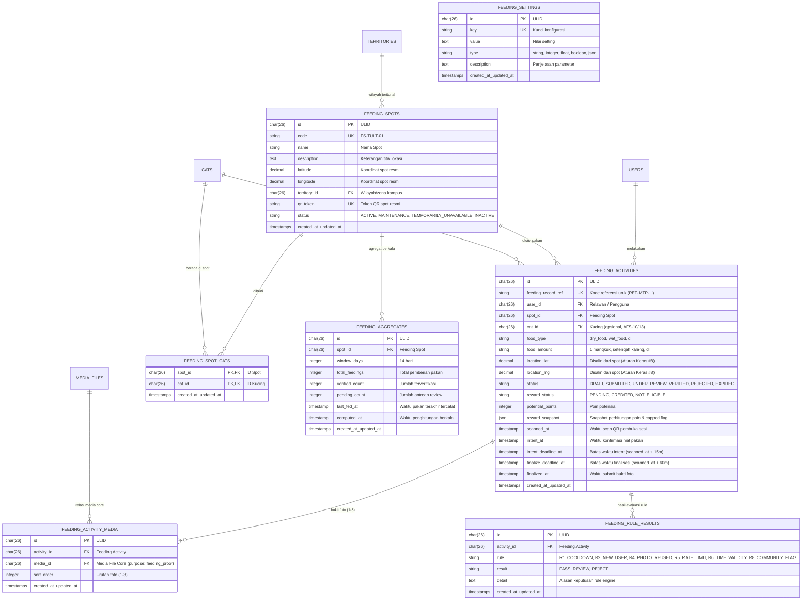

# Entity Relationship Diagram (ERD) - Adopt Feeding Spot (AFS)

Modul **Adopt Feeding Spot (AFS)** mengelola titik stasiun pakan kucing kampus, sesi pemberian pakan relawan berbasis QR token, pemeriksaan bukti otomatis tanpa GPS pengguna, serta agregasi kebutuhan pakan 14 hari.

## Diagram Hubungan Entitas (Mermaid)

## Karakteristik Khusus Skema AFS
1. **Aturan Keras #1 & #8 (Tanpa Tabel Duplikat Kucing & Tanpa GPS Pengguna):**
   - Tidak ada tabel `cats` buatan sendiri di modul ini; relasi merujuk ke tabel inti `cats`.
   - Koordinat pada `feeding_activities` (`location_lat`, `location_lng`) disalin langsung dari `feeding_spots` saat QR dipindai. Tidak ada pengiriman/penyimpanan koordinat GPS dari perangkat relawan ke server.
2. **Pemisahan Status Aktivitas dan Status Reward:**
   - `status`: status siklus hidup sesi pemberian pakan (`DRAFT` -> `UNDER_REVIEW` / `VERIFIED` / `REJECTED` / `EXPIRED`).
   - `reward_status`: status perolehan poin relawan (`PENDING`, `CREDITED`, `NOT_ELIGIBLE`). Jika relawan telah melampaui kuota harian (`daily_cap_count`), aktivitas tetap berstatus `VERIFIED` namun `reward_status` berstatus `NOT_ELIGIBLE` (`reward_capped: true`).
3. **Relasi Spot-Kucing (`feeding_spot_cats`):**
   - Mendukung hub kucing (`CatActionProviderInterface`) sehingga aksi tombol pakan pada profil kucing hanya muncul jika kucing terdaftar aktif pada spot di sekitar.
