# Entity Relationship Diagram (ERD) - Adopt Feeding Spot (AFS)

Modul **Adopt Feeding Spot (AFS)** mengelola titik stasiun pakan kucing kampus, sesi pemberian pakan relawan berbasis QR token, pemeriksaan bukti otomatis tanpa GPS pengguna, serta agregasi kebutuhan pakan 14 hari.

## Diagram Hubungan Entitas (Mermaid)

```mermaid
erDiagram
    USERS ||--o{ FEEDING_ACTIVITIES : "melakukan"
    FEEDING_SPOTS ||--o{ FEEDING_ACTIVITIES : "lokasi pakan"
    FEEDING_SPOTS ||--o{ FEEDING_SPOT_CATS : "dihuni"
    CATS ||--o{ FEEDING_SPOT_CATS : "berada di spot"
    CATS ||--o{ FEEDING_ACTIVITIES : "kucing yang diberi makan (opsional)"
    TERRITORIES ||--o{ FEEDING_SPOTS : "wilayah teritorial"
    MEDIA_FILES ||--o| FEEDING_SPOTS : "foto dokumentasi spot (opsional)"
    FEEDING_SPOTS ||--o{ FEEDING_AGGREGATES : "agregat berkala"
    FEEDING_SPOTS ||--o{ FEEDING_SPOT_HISTORIES : "riwayat lokasi & perubahan"
    FEEDING_SPOTS ||--o{ FEEDING_SPOT_QR_TOKENS : "siklus hidup token QR"
    FEEDING_ACTIVITIES ||--o{ FEEDING_ACTIVITY_MEDIA : "bukti foto (1-3)"
    MEDIA_FILES ||--o{ FEEDING_ACTIVITY_MEDIA : "relasi media core"
    FEEDING_ACTIVITIES ||--o{ FEEDING_RULE_RESULTS : "hasil evaluasi rule"

    FEEDING_SPOTS {
        char(26) id PK "ULID"
        string code UK "SPOT-TULT-01 (Auto-generated & immutable)"
        string name "Nama Spot"
        text description "Keterangan titik lokasi"
        decimal latitude "Koordinat spot resmi"
        decimal longitude "Koordinat spot resmi"
        char(26) territory_id FK "Wilayah/zona kampus"
        char(26) photo_media_id FK "Media File Core (purpose: spot_photo, opsional)"
        string photo_path "Path berkas foto dokumentasi spot"
        string qr_token UK "Token QR spot resmi aktif"
        string status "ACTIVE, MAINTENANCE, TEMPORARILY_UNAVAILABLE, INACTIVE"
        string status_reason "Alasan status non-aktif sementara"
        timestamps created_at_updated_at
    }

    FEEDING_SPOT_HISTORIES {
        char(26) id PK "ULID"
        char(26) spot_id FK "ID Spot"
        string action "CREATED, UPDATED, STATUS_CHANGED, QR_REGENERATED"
        char(26) actor_user_id FK "Admin pelaksana"
        json old_values "Snapshot nilai sebelum perubahan"
        json new_values "Snapshot nilai sesudah perubahan"
        timestamps created_at_updated_at
    }

    FEEDING_SPOT_QR_TOKENS {
        char(26) id PK "ULID"
        char(26) spot_id FK "ID Spot"
        string token UK "Token QR (tanpa prefix MTP1.S.)"
        string status "ACTIVE, REVOKED"
        char(26) issued_by_user_id FK "Admin penerbit"
        char(26) revoked_by_user_id FK "Admin pencabut (saat regenerate)"
        timestamp issued_at "Waktu diterbitkan"
        timestamp revoked_at "Waktu dicabut (saat regenerate)"
        timestamps created_at_updated_at
    }

    FEEDING_SPOT_CATS {
        char(26) spot_id PK,FK "ID Spot"
        char(26) cat_id PK,FK "ID Kucing"
        timestamps created_at_updated_at
    }

    FEEDING_ACTIVITIES {
        char(26) id PK "ULID"
        string feeding_record_ref UK "Kode referensi unik (REF-MTP-...)"
        char(26) user_id FK "Relawan / Pengguna"
        char(26) spot_id FK "Feeding Spot"
        char(26) cat_id FK "Kucing (opsional, AFS-10/13)"
        string food_type "dry_food, wet_food, dll"
        string food_amount "1 mangkuk, setengah kaleng, dll"
        decimal location_lat "Disalin dari spot (Aturan Keras #8)"
        decimal location_lng "Disalin dari spot (Aturan Keras #8)"
        string status "DRAFT, SUBMITTED, UNDER_REVIEW, VERIFIED, REJECTED, EXPIRED"
        string reward_status "PENDING, CREDITED, NOT_ELIGIBLE"
        integer potential_points "Poin potensial"
        json reward_snapshot "Snapshot perhitungan poin & capped flag"
        timestamp scanned_at "Waktu scan QR pembuka sesi"
        timestamp intent_at "Waktu konfirmasi niat pakan"
        timestamp intent_deadline_at "Batas waktu intent (scanned_at + 15m)"
        timestamp finalize_deadline_at "Batas waktu finalisasi (scanned_at + 60m)"
        timestamp finalized_at "Waktu submit bukti foto"
        timestamps created_at_updated_at
    }

    FEEDING_ACTIVITY_MEDIA {
        char(26) id PK "ULID"
        char(26) activity_id FK "Feeding Activity"
        char(26) media_id FK "Media File Core (purpose: feeding_proof)"
        integer sort_order "Urutan foto (1-3)"
        timestamps created_at_updated_at
    }

    FEEDING_RULE_RESULTS {
        char(26) id PK "ULID"
        char(26) activity_id FK "Feeding Activity"
        string rule "R1_COOLDOWN, R2_NEW_USER, R4_PHOTO_REUSED, R5_RATE_LIMIT, R6_TIME_VALIDITY, R8_COMMUNITY_FLAG"
        string result "PASS, REVIEW, REJECT"
        text detail "Alasan keputusan rule engine"
        timestamps created_at_updated_at
    }

    FEEDING_AGGREGATES {
        char(26) id PK "ULID"
        char(26) spot_id FK "Feeding Spot"
        integer window_days "14 hari"
        integer total_feedings "Total pemberian pakan"
        integer verified_count "Jumlah terverifikasi"
        integer pending_count "Jumlah antrean review"
        timestamp last_fed_at "Waktu pakan terakhir tercatat"
        timestamp computed_at "Waktu penghitungan berkala"
        timestamps created_at_updated_at
    }

    FEEDING_SETTINGS {
        char(26) id PK "ULID"
        string key UK "Kunci konfigurasi"
        text value "Nilai setting"
        string type "string, integer, float, boolean, json"
        text description "Penjelasan parameter"
        timestamps created_at_updated_at
    }
```



## Karakteristik Khusus Skema AFS
1. **Aturan Keras #1 & #8 (Tanpa Tabel Duplikat Kucing & Tanpa GPS Pengguna):**
   - Tidak ada tabel `cats` buatan sendiri di modul ini; relasi merujuk ke tabel inti `cats`.
   - Koordinat pada `feeding_activities` (`location_lat`, `location_lng`) disalin langsung dari `feeding_spots` saat QR dipindai. Tidak ada pengiriman/penyimpanan koordinat GPS dari perangkat relawan ke server.
2. **Pemisahan Status Aktivitas dan Status Reward:**
   - `status`: status siklus hidup sesi pemberian pakan (`DRAFT` -> `UNDER_REVIEW` / `VERIFIED` / `REJECTED` / `EXPIRED`).
   - `reward_status`: status perolehan poin relawan (`PENDING`, `CREDITED`, `NOT_ELIGIBLE`). Jika relawan telah melampaui kuota harian (`daily_cap_count`), aktivitas tetap berstatus `VERIFIED` namun `reward_status` berstatus `NOT_ELIGIBLE` (`reward_capped: true`).
3. **Relasi Spot-Kucing (`feeding_spot_cats`):**
   - Mendukung hub kucing (`CatActionProviderInterface`) sehingga aksi tombol pakan pada profil kucing hanya muncul jika kucing terdaftar aktif pada spot di sekitar.
4. **Kode Spot Otomatis & Riwayat Lokasi (`feeding_spot_histories`):**
   - Saat admin menambahkan spot baru tanpa mengirimkan `code`, `FeedingSpotManagementService::generateUniqueSpotCode()` menghasilkan kode unik berformat `SPOT-<LOC>-<NN>` (contoh: `SPOT-TULT-01`, `SPOT-GKU-02`) secara *concurrency-safe* berdasarkan lokasi terdekat di Denah Telkom University (38 lokasi resmi).
   - Kode spot bersifat *immutable* setelah dibuat dan tidak berubah ketika nama atau koordinat spot diedit.
   - Setiap pembuatan, pembaruan lokasi/koordinat, perubahan status, atau regenerasi QR dicatat di `feeding_spot_histories` beserta `audit_logs`.
5. **Penyimpanan Foto Dokumentasi Spot (`photo_media_id`, `photo_path`):**
   - Admin dapat mengunggah foto dokumentasi spot (`JPG`, `PNG`, `WEBP` maks 5 MB) saat menambah atau mengedit spot.
   - Berkas disimpan pada disk `public` (`feeding/spots/<spot_id>/<ulid>.<ext>`) dan dicatat ke tabel inti `media_files` dengan `purpose = 'spot_photo'` dan `visibility = 'public'`.
   - Endpoint publik `GET /api/v1/feeding/spots/{id}/photo` menayangkan foto spot tersebut, dan payload spot menyertakan `photo_url` serta `image_url`.
6. **Siklus Hidup QR Spot & Pencabutan Token (`feeding_spot_qr_tokens`):**
   - Payload QR feeding spot resmi mengikuti standar PRD Bagian 5.6: `MTP1.S.<qr_token>`.
   - `FeedingSpotQrCodeService` menghasilkan matriks QR Code standar ISO/IEC 18004 (Byte mode, Error Correction Level L, versi 1–4) dalam format SVG maupun PNG untuk dicetak (`GET /api/v1/admin/feeding/spots/{id}/qr-sheet`, `GET /api/v1/admin/feeding/spots/qr-sheet`) atau diunduh (`GET /api/v1/admin/feeding/spots/{id}/qr-download?format=png|svg`).
   - Ketika admin melakukan **Regenerate QR** (`POST /api/v1/admin/feeding/spots/{id}/qr`), token lama ditandai `REVOKED` pada `feeding_spot_qr_tokens`, dan token baru diterbitkan sebagai `ACTIVE`. Pemindaian menggunakan QR cetakan lama akan ditolak dengan kode error `QR_REVOKED` (`422`).
7. **Prosedur Generate QR Contoh & Uji Scan Ujung ke Ujung (MEOW-28):**
   - Jalankan perintah Artisan berikut untuk mengekspor berkas SVG, PNG, dan lembar cetak HTML seluruh feeding spot aktif ke `storage/app/public/feeding/sample-qr`:
     ```bash
     php artisan feeding:sample-qr
     ```
   - Skenario pengujian ujung ke ujung (tercakup otomatis di `FeedingSpotTest::test_meow_28_qr_code_generation_download_print_regenerate_revocation_and_e2e_scan_scenarios` dan `frontend/test/feeding_spot_test.dart`):
     - **Skenario A (QR Spot Valid):** Scan `MTP1.S.<qr_token>` pada spot `ACTIVE` membuka sesi `DRAFT` (`201`) -> konfirmasi intent (`200`) -> unggah foto bukti & finalisasi (`200`).
     - **Skenario B (QR Salah Tipe):** Scan QR kalung kucing (`MTP1.C.<token>`) ditolak dengan `422 QR_WRONG_TYPE`.
     - **Skenario C (QR Tidak Dikenal / Rusak):** Scan payload acak ditolak dengan `422 QR_INVALID`.
     - **Skenario D (Spot Tidak Tersedia):** Scan QR pada spot `MAINTENANCE`, `TEMPORARILY_UNAVAILABLE`, atau `INACTIVE` ditolak dengan `422 SPOT_UNAVAILABLE` disertai `status_reason`.
     - **Skenario E (Regenerate QR & Pencabutan Token Lama):** Setelah `POST /api/v1/admin/feeding/spots/{id}/qr`, scan QR lama ditolak dengan `422 QR_REVOKED`, sedangkan scan QR baru berhasil membuka sesi (`201`).
     - **Skenario F (Input Kode Spot Manual):** Input kode spot (`SPOT-TULT-01`) pada halaman scan tanpa kamera berhasil membuka sesi pemberian pakan (`201`).
